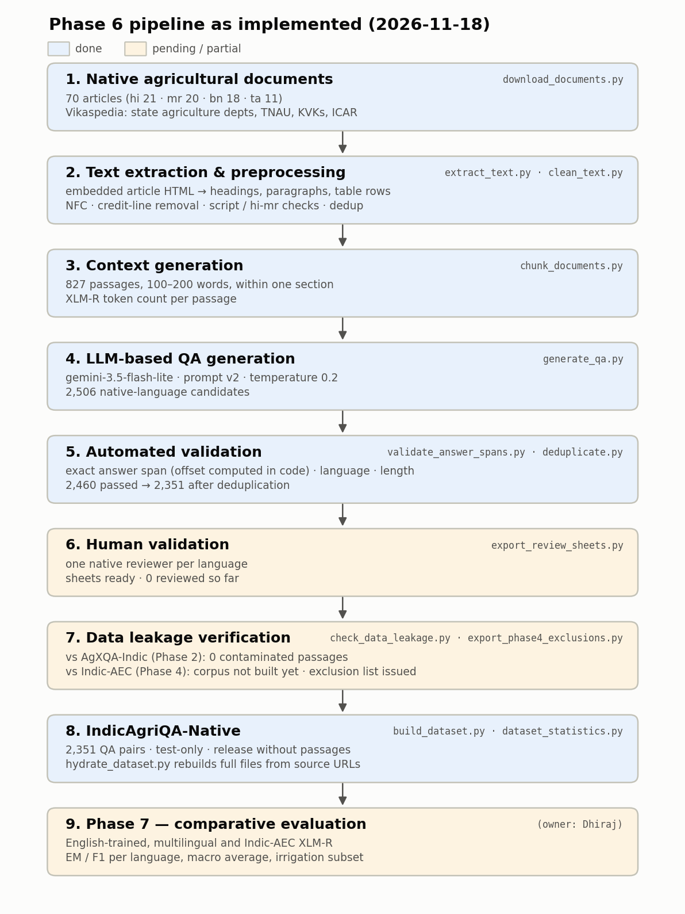
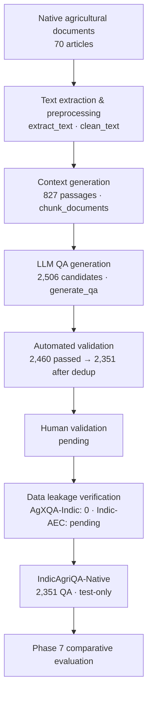
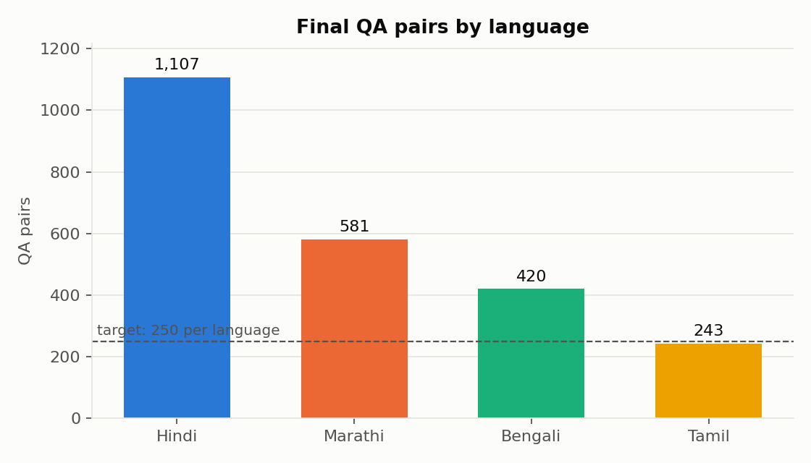
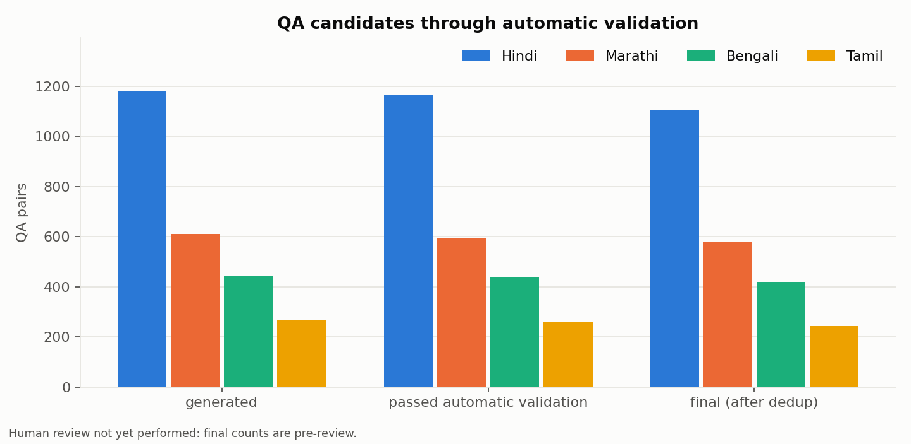
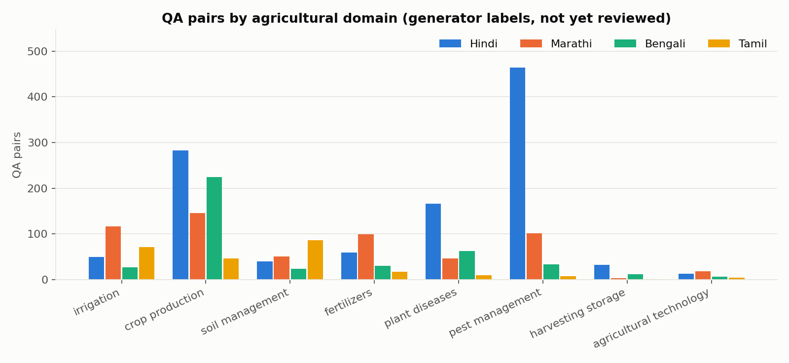
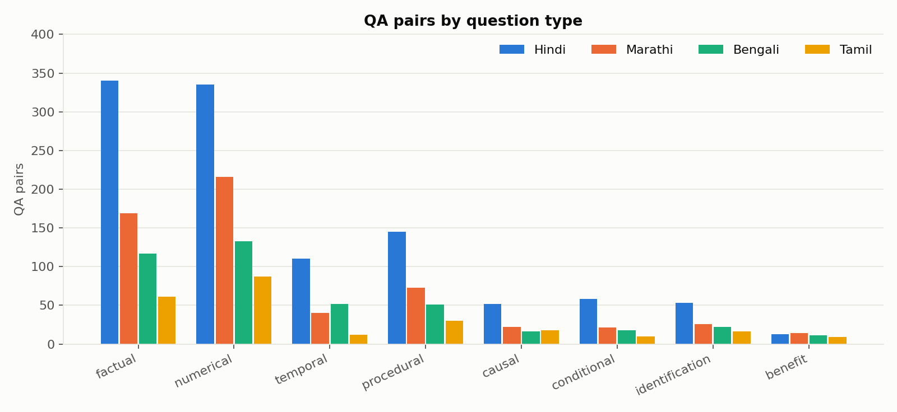
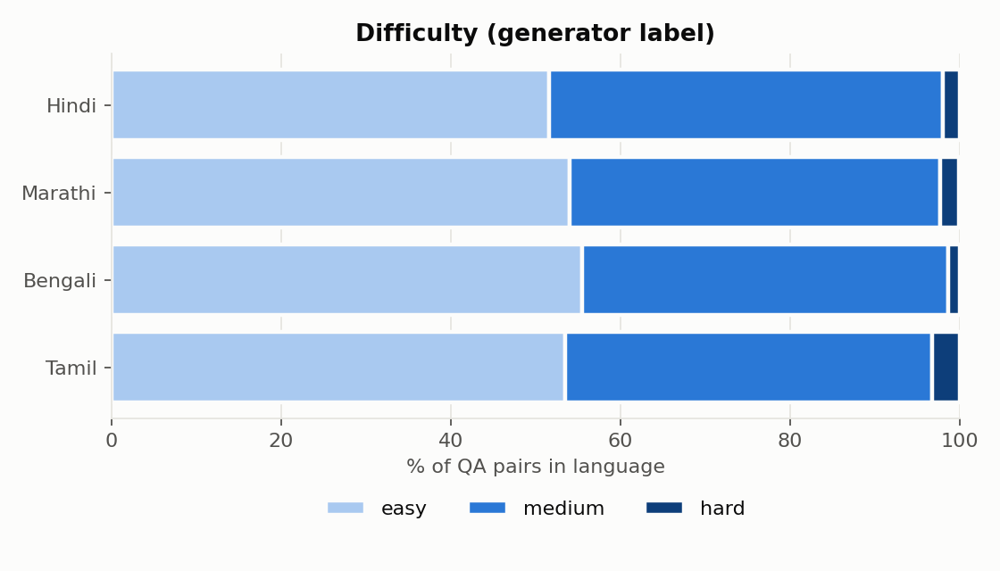
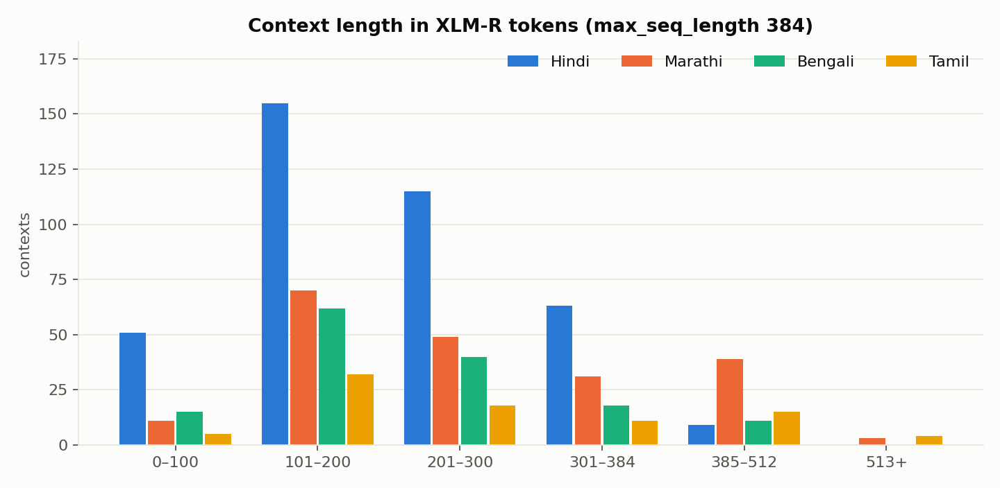
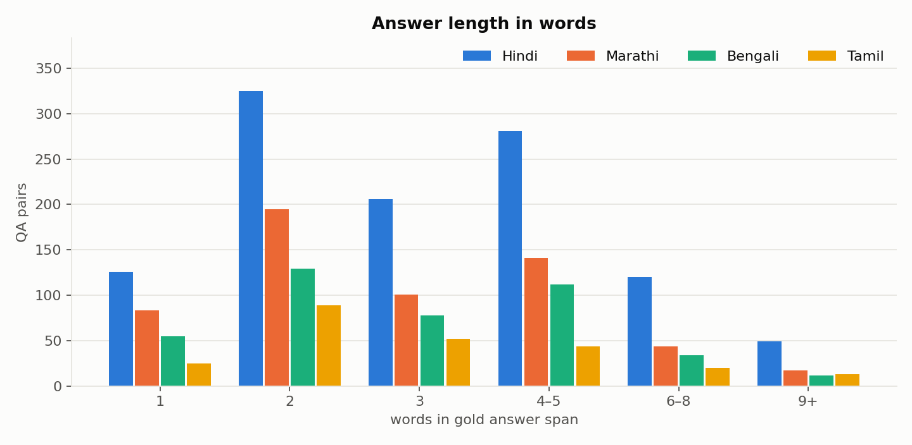
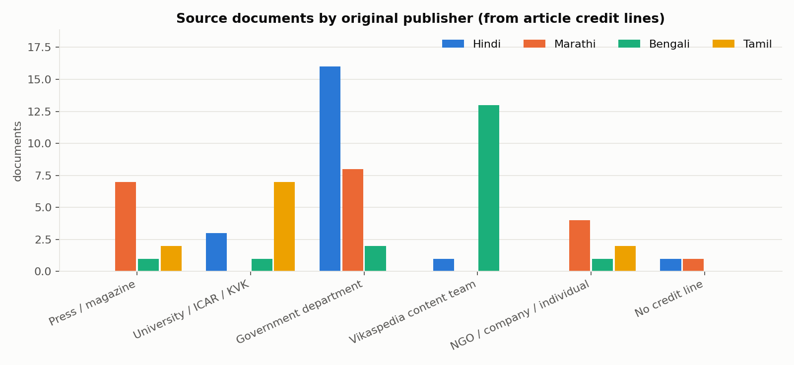

# Phase 6 — Native Indic Agricultural QA Benchmark

**IndicAgriQA-Native**: 2,351 extractive QA pairs written directly in Hindi, Marathi, Bengali and Tamil, built from native agricultural extension articles.

**Owner:** Aditya Saxena · **Status (2026-11-18):** dataset generated and automatically validated. Human review is pending, and the leakage check against Indic-AEC is waiting for the Phase 4 corpus.

| | Hindi | Marathi | Bengali | Tamil | Total |
|---|---|---|---|---|---|
| Final QA pairs | 1,107 | 581 | 420 | 243 | **2,351** |
| Source documents | 21 | 20 | 18 | 11 | 70 |
| Human-reviewed | 0 | 0 | 0 | 0 | 0 |

> **About the passages.** The source text is Vikaspedia content, which may be reproduced only with permission. This repository is public, so the committed dataset contains questions, answers, answer offsets and a SHA-256 of each passage, **but not the passage text**. `scripts/hydrate_dataset.py` rebuilds the full files from the public source URLs and verifies every passage byte for byte. See [§14](#14-dataset-schema) and [§24](#24-reproducibility-instructions).

---

## 1. Introduction

Phase 2 (AgXQA-Indic) translated an English agricultural QA benchmark into four Indic languages. Translation keeps the English source's content (US irrigation extension material) and its phrasing. It cannot show whether a model understands agricultural knowledge as it is written and practised in India.

Phase 6 builds a held-out benchmark from documents **originally written** in Hindi, Marathi, Bengali and Tamil. Passages, questions and answers all originate in the native language.

## 2. Research Motivation

- Translated benchmarks reward models for handling translation artefacts and foreign agronomy, such as US crops and units. Native text has regional crops (jute, betel leaf, soybean in Marathwada), local units and native terminology.
- Phase 7 compares an English-trained XLM-R, a multilingual fine-tuned XLM-R and an Indic-AEC domain-adapted XLM-R. Measuring their real-world benefit needs native evaluation data that none of them has seen.
- Research question: *does multilingual fine-tuning and agricultural domain adaptation improve answering of genuinely native Indic agricultural questions, beyond machine-translated benchmarks?*

## 3. Objective

Build a test-only extractive QA benchmark (SQuAD-style, exact answer spans) in four languages with:

- documented provenance for every passage
- programmatically verified answer offsets
- automatic quality checks
- per-language human review
- proof that no benchmark passage leaks into training or adaptation data

## 4. Difference Between AgXQA-Indic and Native Indic QA

| | Phase 2: AgXQA-Indic | Phase 6: IndicAgriQA-Native |
|---|---|---|
| Original content | English (AgXQA) | Native Indic extension articles |
| Agricultural knowledge | US irrigation extension | Indian state agriculture depts, TNAU, KVKs |
| Translation | Yes | No |
| Questions | Translated | Generated directly in the target language |
| Gold answers | Translated, then re-aligned | Exact spans of the native passage |
| Parallel across languages | Yes (shared IDs) | No (independent IDs) |
| Cross-lingual consistency metric | Applicable | Not applicable |
| Purpose | Cross-lingual transfer | Native agricultural QA |

## 5. Supported Languages

| Language | Code | Script | ID prefix | Reviewer |
|---|---|---|---|---|
| Hindi | `hi` | Devanagari | `NATIVE_HI_` | Aditya Saxena |
| Marathi | `mr` | Devanagari | `NATIVE_MR_` | Aditya Pise |
| Bengali | `bn` | Bengali | `NATIVE_BN_` | Saunak |
| Tamil | `ta` | Tamil | `NATIVE_TA_` | Dhiraj |

Hindi and Marathi share a script, so the pipeline separates them with function-word votes (§9).

## 6. Agricultural Document Sources

84 candidate documents were assessed and **70 were used**. All 70 are Unicode HTML articles from **Vikaspedia**, the Government of India's multilingual portal (MeitY / C-DAC). Every article ends with a credit line naming its original publisher. These credits are recorded per document in `sources/*_sources.csv` (column `notes`).

| Original publisher (from credit lines) | Hindi | Marathi | Bengali | Tamil |
|---|---|---|---|---|
| Government department (Bihar, Jharkhand, UP, MP, Maharashtra, Kisan Portal, MahaNews) | 16 | 8 | 2 | 0 |
| University / ICAR / KVK (TNAU, *Valarum Velanmai*, KVK Needamangalam, ICAR-NCIPM, ICAR-CAZRI) | 3 | 0 | 1 | 7 |
| Vikaspedia content team (West Bengal) | 1 | 0 | 13 | 0 |
| Press / magazine (Agrowon, Dinamani, Pasumai Vikatan) | 0 | 7 | 1 | 2 |
| NGO / company / individual expert | 0 | 4 | 1 | 2 |
| No credit line | 1 | 1 | 0 | 0 |

The **14 excluded candidates** are kept in the source CSVs with `include=no` and a reason:

- **TNAU Agritech Tamil pages:** they mirror the English portal file for file, so they are probably translations.
- **University and ICAR PDFs:** their text layers are corrupt (§9).
- **VNMKV leaflets:** image-only scans, or links that return 404.

`sources/SOURCES_NOTES.md` documents every decision.

## 7. Dataset Construction Architecture





## 8. Document Collection Methodology

1. **Discovery.** Portals named in the plan were searched with native-language queries: ICAR, IARI, ICAR-CIAH, MPKV, VNMKV, Matir Katha, BCKV, UBKV, TNAU and Vikaspedia.
2. **Verification.** Every candidate was fetched, and its text checked for script ratio, garbled-text ratio and word count before inclusion.
3. **Provenance.** Each document's metadata is recorded in `sources/source_manifest.csv`:
   - identity: `document_id`, title, organisation, region, domain
   - origin: source URL, licence status, `language_origin`
   - retrieval: SHA-256, download date
4. **Licence.** Vikaspedia's portal policy allows reproduction with attribution, only after permission is requested from vikaspedia@cdac.in. Third-party newspaper material is excluded from that permission.
5. **Separation from Phase 4.** `sources/phase4_exclusion_list.csv` lists all 84 assessed documents (70 reserved, 14 candidates). Indic-AEC must not ingest them.

```bash
python phase_06_native_indic_qa/scripts/download_documents.py
```

## 9. Text Extraction and Preprocessing

**Extraction** (`extract_text.py`). Vikaspedia ships an empty page body and embeds the article HTML in JSON (`__NEXT_DATA__` and JSON-LD `articleBody`). Generic extractors read only a flattened copy and cut it off at 60,000 characters. The extractor therefore parses the embedded HTML and keeps headings, paragraphs, list items and table rows (cells joined with `|`) as separate lines. PDFs are read page by page with PyMuPDF. Pages with unusable text are flagged for Tesseract OCR.

**Detecting corrupt PDF text.** Three failure modes were found in real university and ICAR PDFs. All three are detected by `garbled_ratio` in `common.py`:

| Failure | Example | Seen in |
|---|---|---|
| Legacy non-Unicode font | `‘hmË‘m ’w$bo` for महात्मा फुले | MPKV *Krishidarshani*, *Shri Sugi*; TNAU farmer handbook |
| Glyphs mapped to wrong code points | `षिद्यापीठाने`, `िाधनिंपत्ती` | MPKV 2025 recommendations |
| Doubled vowel signs, dropped half-letters | `कीी`, `उत्ादन`, `किलोग्ाम` | ICAR-CRRI bulletin 251, ICAR-IIMR millet books |

**Cleaning** (`clean_text.py`) applies these steps:

1. NFC normalisation, keeping ZWJ/ZWNJ (Bengali and Marathi spelling depends on them).
2. Removal of repeated headers, footers, page numbers and article credit lines.
3. Script-ratio filter.
4. Hindi vs Marathi separation by function-word majority (≥2 votes and more than twice the other language). Abbreviations such as `हे.` and `को.` are ignored.
5. Short complete sentences are merged into the preceding paragraph rather than dropped.
6. Removal of exact and near-duplicate paragraphs (rapidfuzz ≥ 92).

## 10. Context Generation

`chunk_documents.py` packs paragraphs into **100–200-word passages that never cross a section heading**. Each passage keeps its heading as `title`, and short sections of at least 40 words stand alone. Every passage records its document ID, a keyword domain hint and its **XLM-R token count**, measured with the `xlm-roberta-base` tokenizer (no model weights). The token count matters because Indic text tokenises much longer than its word count suggests. 61 passages exceed the 384-token QA window and are flagged.

| | Hindi | Marathi | Bengali | Tamil |
|---|---|---|---|---|
| Passages | 393 | 203 | 146 | 85 |
| Mean words | 123 | 123 | 102 | 108 |
| Mean XLM-R tokens | 205 | 262 | 211 | 263 |

## 11. LLM-Based Question Generation

`generate_qa.py` sends **one Gemini call per passage**. The prompt asks for 2–3 questions written directly in the passage's language, each with an answer copied verbatim from the passage. Each answer comes with its evidence sentence, question type, difficulty and domain.

- **Resumable.** Every response is appended at once, and a rerun skips finished passages.
- **Budget-aware.** Two API keys rotate, each with its own per-day budget. A key is switched out after its budget is spent or after two quota errors.
- **Recorded.** Every raw record stores the model, prompt version, prompt hash, settings, attempt count and key slot (the variable name only).

Run statistics: 827 passages, 907 API calls, 2,506 candidates. Two responses contained invalid JSON escapes; they were recovered from the stored response without re-calling the API.

## 12. Prompt Engineering

The prompt is `prompts/qa_generation_prompt.txt` (sha256 prefix `24e20dd19be5`). It is the template from the Phase 6 plan, plus explicit field definitions. It went through one revision:

| Version | Change | Effect on a 12-passage trial |
|---|---|---|
| v1 | Plan template | Some answers were whole sentences (max 21 words in Hindi, 18 in Bengali) |
| **v2 (used)** | Adds: *answer_text is the shortest exact span, usually 1–8 words, never a whole sentence, no final punctuation* | Max answer length fell to 9 (Hindi) and 4 (Bengali) words; all 36 trial questions passed |

The v1 trial outputs are archived in `data/native_indic_qa/generated_qa/trial_prompt_v1/` (git-ignored).

## 13. Experimental Configuration

All settings are in `configs/generation_config.yaml`.

| Setting | Value |
|---|---|
| Model | `gemini-3.5-flash-lite` (Google GenAI API) |
| Temperature | 0.2 |
| Response format | JSON (`response_mime_type: application/json`) |
| Questions per passage | 2–3 requested, at most 3 kept |
| Retries | 3 per passage; quota errors switch keys |
| Rate limit | 4.5 s between calls |
| Prompt version | v2 |
| Chunk size | 100–200 words (hard max 260); short sections ≥ 40 words kept |
| Tokenizer for length checks | `xlm-roberta-base` |
| Generation date | 2026-11-18 |

## 14. Dataset Schema

Three representations of the same 2,351 records:

| File | In git | Contents |
|---|---|---|
| `data/native_indic_qa/final/{hindi,marathi,bengali,tamil,test}.jsonl` | ✅ | Release: question, answers and offsets, `context_id`, `context_sha256`, metadata. **No passage text.** |
| `data/native_indic_qa/full/{lang}.jsonl`, `full/test.jsonl` | ❌ | SQuAD-style with `context` (the plan's schema) |
| `data/native_indic_qa/full/test.shared.jsonl` | ❌ | The team's shared contract (`schemas/qa.schema.json`); passes `python -m shared.validate` |

Release record:

```json
{"id": "NATIVE_TA_000001", "language": "ta", "split": "test",
 "source_document_id": "TA_DOC_001", "context_id": "TA_DOC_001_C001",
 "context_sha256": "d01c6f0a…", "context_chars": 1095,
 "question": "பாரம்பரிய முறையான மேற்பரப்பு பாசனம் எந்த காரணத்திற்காக …?",
 "answers": [{"text": "எளிமையான அமைப்பு முறை, …", "answer_start": 183}],
 "metadata": {"document_id": "TA_DOC_001", "domain": "irrigation", "question_type": "causal",
              "difficulty": "medium", "generation_model": "gemini-3.5-flash-lite", "prompt_version": "v2",
              "human_validated": false, "review_status": "unreviewed", "source_url": "https://…"}}
```

Full record (after hydration): `{"id", "title", "language", "context", "question", "answers": {"text": [...], "answer_start": [...]}, "metadata"}`.

IDs are **not aligned across languages**. `answer_start` is a Python Unicode character index into the NFC context.

## 15. Automated Validation

`validate_answer_spans.py` never trusts the LLM's offsets:

| Check | Outcome |
|---|---|
| Answer is an exact contiguous substring of the NFC passage (only boundary punctuation and whitespace may be trimmed) | reject |
| Repeated answer string: the evidence sentence picks the occurrence | warning if ambiguous |
| Question in the target script and language (Hindi vs Marathi checked) | reject |
| Answer 2+ characters, ≤ 20 words, ≤ 50% of the passage | reject |
| Question 3–40 words; answer not contained in the question | reject |
| Long answer (> 10 words), full-sentence answer, no question word, copied passage wording, invalid label | warning for reviewers |

`deduplicate.py` then removes exact and fuzzy duplicate questions (token-sort ratio ≥ 90), duplicate answer spans within a passage, and anything beyond 3 questions per passage.

| | Hindi | Marathi | Bengali | Tamil |
|---|---|---|---|---|
| Candidates | 1,181 | 612 | 446 | 267 |
| Passed validation | 1,167 | 595 | 439 | 259 |
| After dedup (final) | 1,107 | 581 | 420 | 243 |

## 16. Human Validation

**Status: not yet performed.** `export_review_sheets.py` produces two sheets per language:

- `human_review/private/<language>_review.csv` includes the passage. It is shared with the reviewer privately.
- `human_review/<language>_review.csv` holds the same rows without passage text. It is committed.

Reviewers score `fluency`, `question_correctness`, `answer_correctness` and `terminology` from 1 to 5. They set `status` to `Accept`, `Needs correction` (with a corrected question or answer copied from the passage) or `Reject`.

`build_dataset.py` applies the reviews and records `human_validated`, `review_status` and `reviewer` in each record. `--second-sample N` creates a second-reviewer subset, and `dataset_statistics.py` reports Cohen's κ once both sheets are filled.

Full rubric: [`human_review/annotation_guidelines.md`](human_review/annotation_guidelines.md). Native-speaker review is not agricultural-expert verification.

## 17. Data Leakage Prevention

Phase 6 is **test-only**: no Phase 6 document or passage may enter fine-tuning (Phase 3) or domain adaptation (Phases 4–5). `check_data_leakage.py` runs three checks:

1. **Phase 4 manifest:** identical file hash, identical normalised URL (one Vikaspedia article has many URL spellings, all normalised by `common.normalize_url`), and near-identical titles.
2. **Passage overlap:** the share of each passage's word 5-grams found anywhere in a training corpus. The threshold is 50%; documents with ≥ 20% contaminated passages are dropped entirely.
3. **Internal:** passages largely repeated across different Phase 6 documents.

Results (`results/data_leakage_report.json`):

| Check | Result |
|---|---|
| Indic-AEC (Phase 4) manifest | Phase 4 has **0 documents** so far, so 0 findings. **Must be re-run when the corpus exists.** |
| Passage overlap vs AgXQA-Indic train (6,520 contexts, Phase 3 fine-tuning data) | **0** passages over threshold; max containment 4% |
| Passage overlap vs AgXQA-Indic test (1,635 contexts) | **0** over threshold; max containment 3% |
| Internal cross-document duplicates | **0** |

## 18. Dataset Statistics

**Table 1 — Language-wise statistics**

| Parameter | Hindi | Marathi | Bengali | Tamil | Total |
|---|---|---|---|---|---|
| Documents collected (assessed) | 24 | 24 | 18 | 18 | 84 |
| Unique documents used | 21 | 20 | 18 | 11 | 70 |
| Context passages | 393 | 203 | 146 | 85 | 827 |
| Generated QA pairs | 1,181 | 612 | 446 | 267 | 2,506 |
| Rejected QA pairs (validation + dedup) | 74 | 31 | 26 | 24 | 155 |
| Human-reviewed QA pairs | 0 | 0 | 0 | 0 | 0 |
| **Final QA pairs** | **1,107** | **581** | **420** | **243** | **2,351** |
| Avg. context length (words / XLM-R tokens) | 123 / 205 | 123 / 262 | 102 / 211 | 108 / 263 | |
| Avg. question length (words) | 12.6 | 8.3 | 9.1 | 7.6 | |
| Avg. answer length (words) | 3.6 | 3.2 | 3.3 | 3.4 | |

**Table 2 — Agricultural domain distribution** (generator labels, not yet human-checked)

| Domain | Hindi | Marathi | Bengali | Tamil |
|---|---|---|---|---|
| Irrigation and water management | 50 (4.5%) | 117 (20.1%) | 27 (6.4%) | 71 (29.2%) |
| Crop production | 283 | 146 | 225 | 46 |
| Soil management | 40 | 51 | 24 | 86 |
| Fertilizers | 59 | 99 | 30 | 17 |
| Plant diseases | 166 | 46 | 63 | 10 |
| Pest management | 464 | 101 | 33 | 8 |
| Harvesting and storage | 32 | 3 | 12 | 1 |
| Agricultural technology | 13 | 18 | 6 | 4 |

Overall, irrigation is **11.3%** of QA pairs, against the planned 30% (§23).

## 19. Dataset Quality Evaluation

**Table 3 — Dataset quality assessment**

| Metric | Hindi | Marathi | Bengali | Tamil |
|---|---|---|---|---|
| Answer-span validity (%) | 99.2 | 98.7 | 98.9 | 97.8 |
| Automatic validation pass rate (%) | 98.8 | 97.2 | 98.4 | 97.0 |
| Human review coverage (%) | 0 | 0 | 0 | 0 |
| Question correctness (%) | pending | pending | pending | pending |
| Answer correctness (%) | pending | pending | pending | pending |
| Human acceptance rate (%) | pending | pending | pending | pending |
| Duplicate rate (%) | 3.2 | 0.3 | 0.5 | 0.4 |
| Data leakage count | 0 | 0 | 0 | 0 |

How each row is defined:

- **Answer-span validity:** share of candidates whose answer is an exact span of the passage.
- **Duplicate rate:** exact or fuzzy duplicate questions, plus duplicate answer spans, as a share of validated candidates.
- **Data leakage count:** checks run so far (§17); Indic-AEC is not yet checked.
- **Human metrics:** computed by `dataset_statistics.py` once reviews are entered. Nothing is estimated in the meantime.

## 20. Visualizations

All figures are computed from the actual dataset by `dataset_statistics.py`. Colours are fixed per language.

| | |
|---|---|
|  |  |
|  |  |
|  |  |
|  |  |

The human-validation-outcomes chart is produced automatically once reviews exist.

## 21. Error Analysis

`results/error_analysis.csv` has 438 rows: every rejected, removed or flagged candidate, with stage, reason, question and answer.

| Stage | Reason | Count |
|---|---|---|
| Automatic validation | answer not an exact span of the passage | 28 |
| | answer too short (< 2 characters) | 7 |
| | answer too long (> 20 words) | 5 |
| | question text garbled | 3 |
| | answer copied inside the question | 2 |
| | answer is most of the passage / empty answer | 2 |
| Deduplication | more than 3 questions for one passage | 67 |
| | exact duplicate question | 22 |
| | fuzzy duplicate question | 19 |
| | same answer span twice in one passage | 1 |
| Review flags (kept, flagged for reviewers) | answer string occurs more than once in the passage | 135 |
| | no question word (possible yes/no) | 67 |
| | long answer (> 10 words) | 38 |
| | answer outside its evidence sentence | 19 |
| | question copies passage wording | 13 |
| | answer is a full sentence | 9 |

Two problems were found by reading questions rather than through automatic checks. Reviewers should look for them:

- **Context-dependent questions:** about 80 questions use "this …" (`इस`, `এই`, `இந்த`) and may need the passage to make sense.
- **Mixed-script typos:** 3 questions have Latin letters inside an Indic word, e.g. `NATIVE_HI_000954` "पत्ती फुदka".

## 22. Key Findings

1. **Native digital sources are scarce in usable form.** Most university and ICAR PDFs fail text extraction in one of three ways (§9). Clean native text came almost entirely from Vikaspedia's HTML articles.
2. **Exact-span generation is reliable with a constrained prompt.** 98.2% of 2,506 candidates passed automatic validation. Asking explicitly for minimal spans (prompt v2) removed the whole-sentence answers seen in v1.
3. **Indic passages are long for XLM-R.** Marathi and Tamil average about 262 tokens for about 110–120 words, so 61 passages exceed a 384-token window. Phase 7 should use doc-stride.
4. **The native benchmark is disjoint from the translated one.** No passage shares more than 4% of its 5-grams with AgXQA-Indic, which supports the comparison planned for Phase 7.
5. **Topic coverage follows what native sources publish.** Hindi sources are heavy on pest management and Bengali on crop production; irrigation reaches 29% only in Tamil.

## 23. Limitations

- **Not human-reviewed yet.** All 2,351 pairs have `human_validated: false`. Report Phase 7 results as "pre-review" until review is complete.
- **Indic-AEC leakage not yet checked.** Phase 4 has no corpus; re-run `check_data_leakage.py --phase4-corpus …` before final evaluation.
- **Topic imbalance.** Irrigation is 11.3% overall (target 30%) and only 4.5% in Hindi and 6.4% in Bengali. Report the irrigation subset separately and with its size.
- **Uneven language sizes.** Hindi has 4.6 times as many pairs as Tamil. Use macro-averages across languages.
- **Generated questions.** An LLM wrote the questions, so they can be more formal than farmers' questions. The labels (domain, type, difficulty) are also the generator's.
- **Origin.** Vikaspedia articles are credited to native publishers, but a few (Kisan Portal, the Bengali "portal content team") may be translations, and reviewers should confirm. One Bengali article (`BN_DOC_018`) is credited to a Bangladeshi scientist.
- **Licence.** Passages cannot be redistributed until Vikaspedia grants permission. Nine newspaper-credited documents need separate rights.
- **Single generator.** All questions come from one model at one temperature; style biases are not measured.

## 24. Reproducibility Instructions

```bash
pip install -r phase_06_native_indic_qa/requirements.txt
```

**A. Rebuild the full dataset from the release.** This needs no API key.

```bash
S=phase_06_native_indic_qa/scripts
python $S/download_documents.py
python $S/extract_text.py
python $S/clean_text.py
python $S/chunk_documents.py
python $S/hydrate_dataset.py
```

`hydrate_dataset.py` checks each rebuilt passage against its `context_sha256` and each answer span against its passage. It reports any record whose source page has changed since 2026-11-18. The round trip on 2026-11-18 was byte-identical for all 2,351 records.

**B. Re-run generation from scratch.** Put `GEMINI_API_KEY` (optionally `GEMINI_API_KEY_2`) in `.env` at the repo root.

```bash
python $S/generate_qa.py --dry-run
python $S/generate_qa.py --languages all --domain irrigation
python $S/generate_qa.py --languages all
python $S/validate_answer_spans.py
python $S/deduplicate.py
python $S/export_review_sheets.py
python $S/check_data_leakage.py --phase4-manifest phase_04_indic_aec_corpus/sources.csv \
    --compare agxqa_indic_train=<train_flat_multilingual_clean.jsonl>:context
python $S/build_dataset.py --include-unreviewed
python $S/dataset_statistics.py
python $S/plot_architecture.py
python -m shared.validate data/native_indic_qa/full/test.shared.jsonl
```

A new LLM run produces different questions. Record the model version and prompt hash; both are written into every raw record and `results/generation_report.json`.

**Folder layout**

```
phase_06_native_indic_qa/
├── configs/generation_config.yaml    prompts/qa_generation_prompt.txt
├── scripts/      14 pipeline scripts (common.py holds shared paths and checks)
├── sources/      per-language source lists, manifest, exclusion list, notes
├── human_review/ annotation_guidelines.md, public sheets (private/ is git-ignored)
├── results/      reports (*.json), error_analysis.csv, plots/
└── docs/         dataset_card.md, methodology.md, architecture.png
data/native_indic_qa/
├── final/        release files (no passages) — committed
├── full/         full files with passages — git-ignored, rebuilt by hydrate_dataset.py
├── metadata.csv
└── raw_documents/ processed_contexts/ generated_qa/ validated_qa/   — git-ignored
```

## 25. Contributors

| Person | Role |
|---|---|
| Aditya Saxena | Phase 6 owner: pipeline, source collection, generation, validation, Hindi review |
| Aditya Pise | Marathi review; Phase 4 (Indic-AEC) owner, responsible for the exclusion list |
| Saunak | Bengali review |
| Dhiraj | Tamil review; Phase 7 evaluation |

## 26. References

- AgXQA: Agricultural Extension Question Answering dataset (MSU-CECO), `msu-ceco/agxqa_v1`.
- Rajpurkar et al., *SQuAD: 100,000+ Questions for Machine Comprehension of Text*, EMNLP 2016.
- Conneau et al., *Unsupervised Cross-lingual Representation Learning at Scale* (XLM-R), ACL 2020.
- Vikaspedia, Ministry of Electronics and IT / C-DAC: https://vikaspedia.in (portal policies: https://vikaspedia.in/portalpolicies/).
- Original publishers credited per document in `sources/*_sources.csv`: state agriculture departments of Bihar, Jharkhand, Uttar Pradesh, Madhya Pradesh and Maharashtra; Tamil Nadu Agricultural University; ICAR institutes; Krishi Vigyan Kendras.
- Google GenAI SDK and Gemini API (`gemini-3.5-flash-lite`).
- PyMuPDF, trafilatura, BeautifulSoup, rapidfuzz, Hugging Face `transformers` (XLM-R tokenizer), matplotlib.
